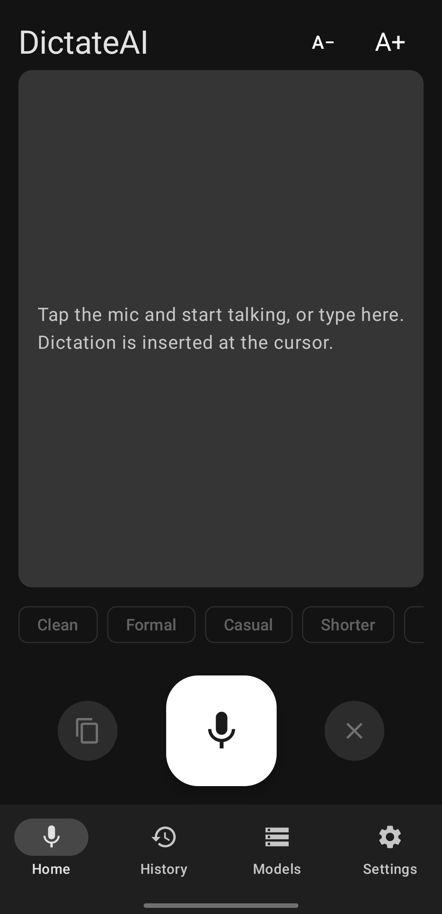
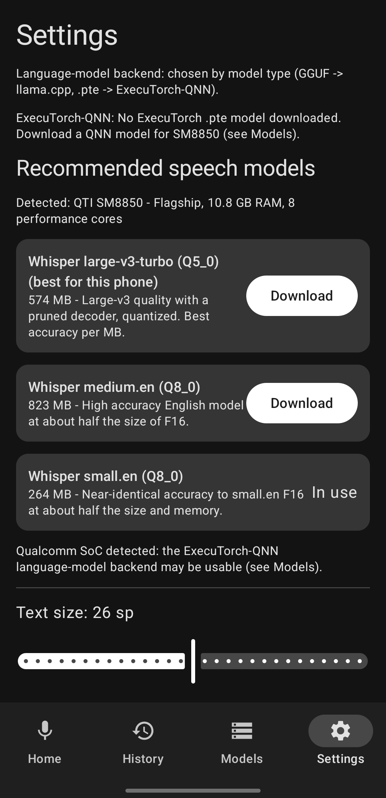
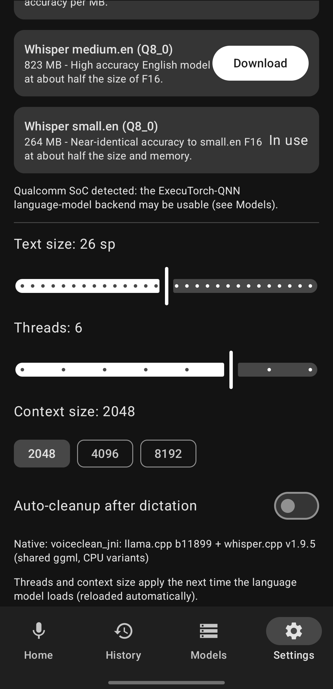

# DictateAI

Fully on-device dictation for Android: live speech-to-text with [whisper.cpp](https://github.com/ggml-org/whisper.cpp),
optional text cleanup / rewriting (formal, casual, shorter, longer...) with [llama.cpp](https://github.com/ggml-org/llama.cpp)
or ExecuTorch + Qualcomm QNN. English only. Nothing leaves the phone except model downloads from Hugging Face.

Target: Samsung Galaxy S / Snapdragon 8 and 7 series (arm64-v8a, Android 12+, API 31+).

## Screenshots
<p align="center">
  
  
  
</p>

## Install (prebuilt APK)
1. Copy the APK (or `adb install -r dist/voiceclean-debug.apk`).
2. Allow "install unknown apps" for your file manager/browser when prompted.
3. Open DictateAI, grant the microphone permission.
4. Settings shows the speech models recommended for your phone; download one (or use the Models tab).
5. Optional: download a cleanup model in Models to enable the rewrite buttons.

The APK is debug-signed (not for the Play Store). Models are stored in the app's external files dir and can be deleted in the Models tab.

## Build from source (production / release)
Requirements: Linux/macOS, JDK 17, Android SDK with platform 35, build-tools 35.0.0, NDK 27.2.12479018, CMake 3.22.1, ~10 GB free disk, internet.

```bash
export ANDROID_HOME=~/android-sdk
yes | $ANDROID_HOME/cmdline-tools/latest/bin/sdkmanager --licenses
$ANDROID_HOME/cmdline-tools/latest/bin/sdkmanager "platforms;android-35" "build-tools;35.0.0" "ndk;27.2.12479018" "cmake;3.22.1"
echo "sdk.dir=$ANDROID_HOME" > local.properties
```

**1. Create a signing key (once; keep it safe, you need the same key for every update):**
```bash
keytool -genkeypair -v -keystore ~/dictateai-release.jks -alias dictateai \
  -keyalg RSA -keysize 4096 -validity 10000
```
**2. Create `keystore.properties` in the project root (gitignored):**
```
storeFile=/home/you/dictateai-release.jks
storePassword=...
keyAlias=dictateai
keyPassword=...
```
**3. Build:**
```bash
./gradlew testDebugUnitTest      # optional: JVM unit tests
./gradlew assembleRelease        # first build compiles ggml/llama/whisper for 7 CPU variants
```
Output: `app/build/outputs/apk/release/app-release.apk` (~105 MB): signed, not debuggable, native debug symbols stripped. Install with `adb install -r`. Without a keystore the release APK is unsigned and will not install. If the first run times out downloading Gradle, run it again.

## Automated releases (GitHub Actions)
`.github/workflows/release.yml` builds the signed release APK and attaches it to a GitHub Release when you push a tag:
```bash
git tag v0.2.0 && git push origin v0.2.0
```
One-time setup, repo Settings > Secrets and variables > Actions:
| Secret | Value |
|---|---|
| `KEYSTORE_BASE64` | `base64 -w0 ~/dictateai-release.jks` |
| `KEYSTORE_PASSWORD` | keystore password |
| `KEY_ALIAS` | `dictateai` |
| `KEY_PASSWORD` | key password |

You can also run the workflow manually (Actions tab); the APK is then kept as a workflow artifact. Bump `versionCode`/`versionName` in `app/build.gradle.kts` before tagging.

## Where models are stored
`/sdcard/Android/data/com.voiceclean.app/files/models/{stt,llm}/` (app-specific storage). Android deletes this folder when the app is uninstalled.

llama.cpp (b11899) and whisper.cpp (v1.9.5) are vendored under `app/src/main/cpp/third_party`.

## Docs
`CLAUDE.md` (entry point for AI agents), `docs/PLAN.md`, `docs/STATE.md`, `docs/DECISIONS.md`, `docs/BUILD.md`, `docs/QNN.md`, `docs/WHISPER_QNN.md`, `dist/INSTALL.md`.

Note: the Kotlin package and Gradle module are still named `com.voiceclean.app` internally; the app's display name is DictateAI.
